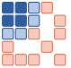
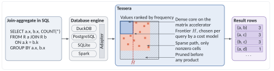
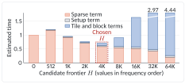
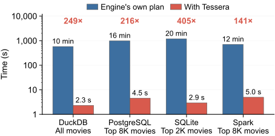

<div align="center">
  
  <h1>Tessera</h1>
  <p><b>Fast join-aggregates over skewed sparse relations, inside your database engine</b></p>
  <p>
    <a href="https://arxiv.org/abs/2610.40620"></a>
    <a href="LICENSE"></a>
    
    
  </p>
  
</div>

## News

- **[2026/11]** Tessera 1.4.4 fixes four problems. Three showed in 1.4.1 with queries derived from TPC-H, TPC-DS, and
  TPCx-BB, the Join Order Benchmark, and LDBC SNB: with `OMP_PROC_BIND` or `GOMP_CPU_AFFINITY` set, loading Tessera no
  longer leaves DuckDB on one CPU; PostgreSQL plans what runs above Tessera on its own estimate of the groups instead
  of one row; and Spark builds Tessera's matrix with all its threads, which halves the time of a pair count derived
  from TPCx-BB Q29. The fourth: on a CPU without AVX-512, code outside Tessera's AVX-512 and AMX paths no longer runs
  their copies of standard library functions, which stopped DuckDB with Tessera linked in, and could stop a library
  loaded after Tessera's SQLite or PostgreSQL module, with an illegal instruction.
- **[2026/11]** Tessera 1.4.1 sums and counts columns that hold NULLs as SQL does, in DuckDB, PostgreSQL, and Spark, so
  a cosine over a pandas DataFrame, a CSV file, or Parquet files read by Spark runs in Tessera. It also runs on pandas
  DataFrames and on Parquet and CSV files at DuckDB's default settings, keeps the top values of each group inside the
  operator (`RANK() ... <= k`), and computes a cosine or a Pearson correlation in one pass. See
  [Supported queries](#supported-queries).
- **[2026/11]** Tessera 1.3.0 runs many more join-aggregate forms: `<>` and `IS DISTINCT FROM` between the two sides,
  `COUNT(DISTINCT k)`, `AVG`, keys and groups of several columns or computed from a column, NULL groups, filters on
  the inputs, and date, timestamp, and decimal columns. PostgreSQL and Spark now prune with `HAVING` and
  `ORDER BY ... LIMIT` too. See [Supported queries](#supported-queries).
- **[2026/11]** Tessera is a [DuckDB community extension](https://duckdb.org/community_extensions/extensions/tessera.html):
  `INSTALL tessera FROM community; LOAD tessera;`
- **[2026/10]** The paper is on [arXiv](https://arxiv.org/abs/2610.40620).
- **[2026/10]** Packages on [PyPI](https://pypi.org/project/sqlite-tessera/),
  [Maven Central](https://central.sonatype.com/artifact/io.github.gyuyeongkim/tessera-spark_2.13), and
  [PGXN](https://pgxn.org/dist/tessera_pg/), and a [browser demo](https://gyuyeongkim.github.io/Tessera-public/).
- **[2026/10]** Tessera released! The operator and its adapters for DuckDB, PostgreSQL, SQLite, and Spark.

## What it does

**Tessera speeds up join-aggregates inside database engines by up to three orders of magnitude, with the same SQL and
the same result.**

A join-aggregate counts or sums the joined rows of each pair of values, as in word co-occurrence, item-to-item
recommendation, or common-neighbor counting:

```sql
SELECT a.x, b.x, COUNT(*)
FROM R a JOIN R b ON a.k = b.k
GROUP BY a.x, b.x
```

A database engine runs it as a hash join and a hash aggregation, which builds one joined row for every two rows that
share a key, often billions of rows. Tessera replaces that part of the plan. It never builds the joined rows, runs the
sparse part of the product on a sparse path, and runs only the dense core on the CPU matrix accelerator.

<p align="center"></p>

**[Try it in your browser](https://gyuyeongkim.github.io/Tessera-public/).** DuckDB-WASM and Tessera, compiled to
WebAssembly, run the same SQL on 10,000 New York Times articles on one thread of your browser and return the same
answer.

## Key features

| Feature | How it works |
|---|---|
| **No joined rows** | Computes the result as the matrix product XᵀX, where X has one row per key and one column per value, in one pass over the input. |
| **Sparse first** | Computes each pair of values once in a dense array of counters and writes only the nonzero cells. Results larger than the memory limit go to disk. |
| **Pruning** | With `HAVING` or `ORDER BY ... LIMIT`, drops the values that cannot reach the threshold before any product, so stricter queries run faster. Results stay exact. DuckDB, PostgreSQL, and Spark pass both forms, and SQLite its `min` argument. |
| **Dense core on AMX** | Runs the small dense block of the most frequent values as 8-bit tiles on the CPU matrix accelerator. |
| **Exact integer sums** | Sums integer weights exactly, in 64 or 128 bits, and raises the engine's own overflow error wherever the engine's plan would. |
| **Cost-based frontier** | The two paths meet at the dense frontier, which a cost model places for each query where an accelerator tile costs as much as the sparse products it replaces. Pruning runs first, so the frontier follows the query, and it stays empty when no block pays off. |
| **Inside the engine** | Hooks into the planners of DuckDB, PostgreSQL, and Spark, so the SQL runs unchanged, and into SQLite as table functions. Follows each engine's cancellation, thread count, and errors, keeps the output within the memory limit of DuckDB, PostgreSQL, and SQLite, and spills the rest to the engine's temporary space within its limit. |

### How the frontier is chosen

The cost model estimates the time of every candidate frontier in one pass over the rows and picks the cheapest.
Raising the frontier moves the pairs of frequent values from the sparse path to tiles on the accelerator. While these
values are frequent, their tiles are full, so the sparse term falls faster than the tile term grows. Once the new
values are rare, their tiles are almost empty but cost as much as full ones, and the total rises again.

<p align="center"></p>

On the full product of the news articles, the model picks 4,096 values, the fastest of the frontiers from 0 to 32,768
values. The operator alone takes 1.60 s there, against 2.28 s without a frontier and 8.11 s with 32,768 values.

## Performance

<p align="center"></p>

| Query | Engine's own plan | With Tessera | Speedup |
|---|---:|---:|---:|
| Word pairs in 300K news articles, DuckDB | 8.6 min | 2.9 s | **178×** |
| Movie pairs in 32M ratings, DuckDB | 9.6 min | 2.3 s | **249×** |
| Gene pairs in a gene network, DuckDB | 29.9 min | 1.00 s | **1,802×** |
| Movie pairs, top 8K movies, PostgreSQL | 16.4 min | 4.7 s | **211×** |
| Movie pairs, top 2K movies, SQLite | 19.9 min | 3.0 s | **400×** |
| Movie pairs, top 8K movies, Spark | 11.7 min | 4.5 s | **156×** |

On the same full products in DuckDB, Tessera is also 5.8–34× faster than SPALM, which runs the product as in-database
linear algebra (54.3 s against 2.9 s on the news articles). Release 1.1.1 reruns the DuckDB measurements
([Reproducing the main results](#reproducing-the-main-results)).

> Measured with release 1.1 on 16 cores of an Intel Xeon Silver 4514Y with AMX, with each engine and
> Tessera on the same cores: DuckDB v1.3.2, PostgreSQL 18.6, SQLite 3.54.1, and Spark 4.2.0. The queries count all pairs of values with
> `COUNT(*)`. SQLite runs its own plan on one thread, and with one thread Tessera is still 99–260× faster there.
> Data: [NYTimes](https://archive.ics.uci.edu/dataset/164/bag+of+words), [MovieLens 32M](https://grouplens.org/datasets/movielens/32m/), and [human_gene1](https://sparse.tamu.edu/Belcastro/human_gene1).

## Install

| Engine | Package | Install |
|---|---|---|
| SQLite in Python | [`sqlite-tessera`](https://pypi.org/project/sqlite-tessera/) on PyPI | `pip install sqlite-tessera` |
| SQLite | `tessera-sqlite-<version>-<platform>.tar.gz` on the [releases page](https://github.com/GyuyeongKim/Tessera-public/releases) | `.load ./tessera` in the shell |
| Spark | `io.github.gyuyeongkim:tessera-spark_2.13` on Maven Central | `--packages io.github.gyuyeongkim:tessera-spark_2.13:1.4.4` |
| PostgreSQL | [`tessera_pg`](https://pgxn.org/dist/tessera_pg/) on PGXN | `pgxn install tessera_pg` |
| DuckDB | [`tessera`](https://duckdb.org/community_extensions/extensions/tessera.html) in the community extensions | `INSTALL tessera FROM community; LOAD tessera;` |

The binary packages are built for Linux on x86-64 and macOS on Apple silicon. In Python:

```python
import sqlite3
import sqlite_tessera

db = sqlite3.connect("data.db")
db.enable_load_extension(True)
sqlite_tessera.load(db)
db.enable_load_extension(False)
print(db.execute("SELECT x0, x1, s FROM tessera_xtx('t', 'k', 'x') LIMIT 5").fetchall())
```

With Spark, add `--conf spark.sql.extensions=tessera.spark.TesseraExtensions` to `spark-sql`, `spark-shell`, or
`spark-submit`. The jar carries the JNI library for both platforms and runs on Java 17 or later.

The PGXN client (`pip install pgxnclient`) builds `tessera_pg` with the `pg_config` on `PATH` and needs PostgreSQL 18
with its server headers and GCC with OpenMP. Then load it with `LOAD 'tessera_pg';` and run `CREATE EXTENSION tessera_pg;`
([PostgreSQL](#engines)).

## Quick start

The SQLite extension needs nothing beyond GCC.

```sh
git clone https://github.com/GyuyeongKim/Tessera-public.git
cd Tessera-public
make -C tests test
curl -fLO https://sqlite.org/2026/sqlite-amalgamation-3540100.zip
unzip -q sqlite-amalgamation-3540100.zip
gcc -O2 -DSQLITE_ENABLE_LOAD_EXTENSION -o sqlite3 \
  sqlite-amalgamation-3540100/shell.c sqlite-amalgamation-3540100/sqlite3.c -lpthread -ldl -lm
SQLITE_SRC=$PWD/sqlite-amalgamation-3540100 ./sqlite/build.sh
./sqlite3 < examples/sqlite.sql
```

`make -C tests test` builds the core library, runs its tests, and prints the variant in use (`amx`, `avx512`, `avx2`,
or `portable` on other CPUs). The example runs one join-aggregate on 500,000 rows with SQLite's own plan and with Tessera. Both print the
same row count and sum, and the `Run Time` lines show the time of each.

## Requirements

| Component | Needs | Tested with |
|---|---|---|
| Core library | Linux on x86-64 with AVX2 or newer (x86-64-v3) or on arm64, GCC or Clang with OpenMP, make | Ubuntu 24.04, GCC 13.3 (x86-64); LLVM 23 with libomp (arm64) |
| DuckDB | git, CMake, Ninja | DuckDB v2.0.0 (pinned submodules) |
| PostgreSQL | PostgreSQL 18 with `pg_config` and server headers | PostgreSQL 18.6 |
| SQLite | SQLite amalgamation, a shell that can load extensions | SQLite 3.54.1 and 3.37.2 |
| Spark | Spark 4, JDK, Scala 2.13 compiler | Spark 4.2.0, JDK 21, Scala 2.13.18 |

On Ubuntu: `sudo apt install build-essential git curl unzip cmake ninja-build`.

On Linux, the library, the extensions, and the Spark JNI library load GCC's OpenMP runtime, `libgomp.so.1` (the
`libgomp1` package on Debian and Ubuntu), which minimal container images may lack.

AMX needs an Intel Xeon of the 4th generation or later and Linux 5.16 or later (`grep -c amx_int8 /proc/cpuinfo`
prints a nonzero count). On other CPUs, Tessera runs every pair on its sparse path with AVX-512 or AVX2 and returns
the same results. On an x86 CPU without AVX2, the adapters leave every query to the engine. On arm64, the library is
one portable build of the sparse path.

## Supported queries

- Self-joins and joins of two relations grouped by columns of both sides:
  `SELECT a.x, b.y, COUNT(*) FROM R a JOIN S b ON a.k = b.k GROUP BY a.x, b.y`.
- Aggregates: `COUNT(*)`, `COUNT` of a column, `COUNT(DISTINCT a.k)`, `SUM(a.v * b.w)`, `SUM(a.v)`,
  `AVG` of such an argument, and a count, a sum and an average of one argument together.
- Pair filters between the two sides' group columns: `<`, `<=`, `>`, `>=`, `<>`, and `IS DISTINCT FROM`.
- Keys of several columns (`a.k = b.k AND a.day = b.day`), and keys computed from one side's columns
  (`a.k % 100 = b.k % 100`, `upper(a.s) = upper(b.s)`).
- Further group columns (`GROUP BY a.category, a.x, b.x`), groups computed from one side's columns that cannot raise
  an error (`a.x % 10`, `upper(a.s)`, `date_trunc('month', a.ts)`), and group columns with NULLs, which form their own
  group.
- Expressions of the groups and aggregates in the select list (`a.c || '-' || a.x`, `COUNT(*) * 2`), `HAVING`,
  `ORDER BY agg DESC LIMIT n [OFFSET m]`, window functions above the aggregate, and `SELECT DISTINCT a.x, b.x`.
- The top values of each group, `RANK()` or `ROW_NUMBER() OVER (PARTITION BY a.x ORDER BY agg DESC) <= k`: the window
  stays above, and the operator keeps only the cells that can reach it. DuckDB, PostgreSQL, and Spark.
- Several different sums in one query, computed in one pass over the joined rows, such as a cosine
  (`SUM(a.v * b.v) / (sqrt(SUM(a.v * a.v)) * sqrt(SUM(b.v * b.v)))`) or a Pearson correlation. Floating-point weights in
  DuckDB, PostgreSQL, and Spark, and integers in DuckDB. Each sum must be a product over one side or a product of one
  side's and the other's, written left to right.
- Filters on either side or on both, with different filters on the two sides.
- Inputs: tables; in PostgreSQL also row-level security, partitioned and inherited tables, subqueries, views, CTEs,
  set-returning functions, foreign tables and `TABLESAMPLE`; in DuckDB also pandas DataFrames, Parquet and CSV files
  (see [Engines](#engines)), Arrow tables and Polars frames, table functions such as `read_csv`, CTEs, a subquery's
  `DISTINCT` or aggregate, and the last join of three relations; in Spark any plan.
- Item similarity (cosine, Jaccard, Dice, overlap) above a threshold.

Keys and groups can be integers, strings, dates and timestamps, and, held as their text, decimals, booleans and in
DuckDB 128-bit and unsigned 64-bit integers. Weights can be integers, summed exactly with the engine's own overflow
errors, decimals of up to 18 digits together, summed exactly at the engine's scale, floating-point numbers, and an
integer or a decimal times a float.

<details>
<summary>SQL spellings that the planner adapters recognize</summary>

DuckDB, PostgreSQL, and Spark recognize:

- comma joins, `JOIN ... ON`, `INNER JOIN`, and `JOIN ... USING (k)`, with the tables and the sides of the equality
  in either order;
- the pair filter (`a.x < b.x`, `b.x > a.x`, `<=`, `>`, `>=`, `<>`, `!=`, `IS DISTINCT FROM`) in `ON` or in `WHERE`;
- `GROUP BY` in either order or by position, and the select list in any order;
- `COUNT(*)`, `COUNT(1)`, `COUNT` of a column, `COUNT(DISTINCT a.k)`, `SUM(a.v * b.v)` in either
  order, and `AVG`;
- `HAVING` over the aggregates and the group columns (`agg >= c` and `agg > c` on a count or a single sum also
  prune), and `ORDER BY` the aggregate, its alias, or its position with `DESC LIMIT n [OFFSET m]`;
- views over the input tables.

These run as the engine's own plan, with the same result:

- `MIN` and `MAX`, which need another semiring than the matrix engine's multiply and add, outer joins, and a third
  relation outside DuckDB's last join;
- in DuckDB, sums that each read one side and no product across the two (`SUM(a.v), SUM(b.v)`), which DuckDB computes
  below the join;
- nondeterministic collations, whose equality is not equality of bytes;
- in PostgreSQL and Spark, `SUM` of `real` / `float` products, which those engines sum in float32;
- in PostgreSQL, several different sums (a cosine) and sums over columns that may hold NULLs when an input is a
  partitioned or inherited table or has its own plan, or when the query holds an aggregate other than `COUNT(*)` beside
  them (`COUNT(col)` and `AVG` of integers run there when a column may hold NULLs).

NULLs: group columns may hold NULLs, and so may summed and counted columns. As in SQL, a joined pair adds to a sum only
when all its factors are non-NULL, a cell without such a pair has a NULL sum, `COUNT(col)` counts the pairs where `col`
is not NULL, and `AVG` divides by that count. DuckDB does this for floating-point and integer weights, PostgreSQL for
`float8` and integer weights, and Spark for `DOUBLE` weights and, in ANSI mode, `INT` and `BIGINT` weights. An integer
sum over columns that may hold NULLs is a sum of one column or of a product of one column from each input. Under a pair
filter, it needs a single comparison of two integer group columns, each the only group column of its input and known to
hold no NULLs (from DuckDB's statistics, a `NOT NULL` constraint, or a non-nullable Spark column). Where a column may
hold NULLs, these stay with the engine: decimal weights, `AVG` of `float8` and a product of an integer and a `float8`
column in PostgreSQL, and in Spark `AVG` of integers and integer weights without ANSI mode. The SQLite table functions
take NULL group keys in mode `'full'` and in `tessera_xty`, leave their rows out with a pair filter, and return an error
on a NULL value. A DuckDB statement prepared while its group and summed columns held no NULLs returns an error that
asks to prepare it again if NULLs arrive later.

Operators: PostgreSQL's adapter recognizes only PostgreSQL's own operators and aggregates, so a user's `*` earlier on
the search path keeps the engine's plan. A group or key computed from a column must be an expression that cannot raise
an error on any value (the adapter computes it on every row of its input, where the engine's plan computes it on the
joined rows only). Spark's adapter leaves `try_sum`, `try_multiply`, `FLOAT` weights, and `SMALLINT` products to Spark,
and integer products without ANSI mode except for `BIGINT`, whose sums wrap as Spark's do.

</details>

## Engines

| Engine | How Tessera attaches | Example |
|---|---|---|
| DuckDB | Optimizer rule, `tessera_sim` table function | `examples/duckdb.sql` |
| PostgreSQL | Planner hook, `tessera_sim` functions | `examples/postgres.sql` |
| SQLite | Table functions `tessera_xtx`, `tessera_xty`, `tessera_sim` | `examples/sqlite.sql` |
| Spark | Planner strategy over JNI | `examples/spark.sql` |

Each example runs one query with the engine's own plan and with Tessera, and shows that Tessera is in the plan.

<details>
<summary><b>DuckDB</b></summary>

```sh
git submodule update --init duckdb extension-ci-tools
GEN=ninja make release
build/release/duckdb < examples/duckdb.sql
```

The build runs from the repository root, as DuckDB's extension template does. It makes a shell with the extension
linked in and a loadable extension under `build/release/extension/tessera/`. In the plan, Tessera appears as
`Tessera`. To load the extension into an official DuckDB v2.0.0 (`duckdb -unsigned`, then `LOAD 'path'`), build with
`DUCKDB_VERSION=v2.0.0 GEN=ninja make release`, since DuckDB loads only extensions stamped with its own version.

On macOS, install LLVM's OpenMP runtime and point the compiler at it:

```sh
brew install libomp
export CMAKE_PREFIX_PATH="$(brew --prefix libomp)"
```

The loadable extension then carries the runtime and needs no libomp where it runs. LLVM's runtime stops a process
that initializes a second copy of it, which another library such as scikit-learn or PyTorch may bring, so run Tessera
on macOS in a process without such a library.

| Setting | Default | Meaning |
|---|---|---|
| `tessera_enabled` | `true` | Use Tessera for matching queries |
| `tessera_frontier` | `-1` | Number of most frequent values on the matrix accelerator (`-1`: cost model) |
| `tessera_min_expansion` | `6` | Leave a self-join to DuckDB below this many estimated joined rows per input row |
| `tessera_min_expansion_cross` | `6` | The same for products of two relations |
| `tessera_min_expansion_measured` | `6` | The same for inputs without distinct counts, on the joined rows the planner counts itself |

Tessera uses DuckDB's `threads`, and output beyond `memory_limit` goes to `temp_directory` within
`max_temp_directory_size`.

A pandas DataFrame or a Parquet or CSV file has no distinct counts, so the planner reads about 262,144 rows of each
input and counts the joined rows itself. It reads a little of every row group of a local Parquet file and of every part
of a DataFrame, so a file sorted by another column is measured like any other. It reads from the start where it cannot
skip ahead: CSV files, remote files, a Parquet file with three quarters of its rows in one row group, inputs with a
pushed filter, and several files without `parquet_metadata_cache`; a join that looks small there stays with DuckDB, with
the same result. Arrow readers are read once only, so Arrow tables and Polars frames stay with DuckDB unless
`tessera_min_expansion_cross` is set to `0`.

```sql
SELECT * FROM tessera_sim('t', 'k', 'x', 'jaccard', 0.5);
SELECT * FROM tessera_sim('t', 'k', 'x', 'cosine', 0.3, v := 'v', mode := 'le');
```

</details>

<details>
<summary><b>PostgreSQL</b></summary>

To build PostgreSQL 18 in a home directory:

```sh
curl -fLO https://ftp.postgresql.org/pub/source/v18.6/postgresql-18.6.tar.bz2
tar xf postgresql-18.6.tar.bz2 && cd postgresql-18.6
./configure --prefix=$HOME/pg18 --without-icu --without-readline --without-zlib
make -j world-bin && make install-world-bin && cd ..
export PATH=$HOME/pg18/bin:$PATH
```

Build the extension, start a server, and run the example:

```sh
make -C postgres && make -C postgres install
initdb -D $HOME/pgdata
pg_ctl -D $HOME/pgdata -l $HOME/pgdata.log start
psql -d postgres -f examples/postgres.sql
```

The Makefile uses the `pg_config` on `PATH` or `PG_CONFIG=/path/to/pg_config`. Load the module with
`LOAD 'tessera_pg';`, or for every session with `session_preload_libraries = 'tessera_pg'`.
`CREATE EXTENSION tessera_pg;` adds `tessera_sim` (integer values) and `tessera_sim_text` (text values).

Settings: `tessera.enabled` (`on`), `tessera.threads` (`0`, the leader and `max_parallel_workers_per_gather` workers
of one query), `tessera.frontier` (`-1`), `tessera.min_expansion` and `tessera.min_expansion_cross` (`0`; a join whose
estimated joined rows per input row, from the `ANALYZE` statistics, lie below the limit stays with PostgreSQL), and
`tessera.trace` (phase times in the server log). The output may use
`work_mem * hash_mem_multiplier` in memory, and the rest goes to the first of `temp_tablespaces` within
`temp_file_limit`. With `a.x < b.x` on text, Tessera orders the values by the comparison's collation.

</details>

<details>
<summary><b>SQLite</b></summary>

The quick start builds the extension (`SQLITE_SRC` is the directory with `sqlite3ext.h`). In the shell:

```sql
.load ./sqlite/tessera
SELECT x0, x1, s FROM tessera_xtx('t', 'k', 'x');                    -- COUNT(*) over all ordered pairs
SELECT x0, x1, s FROM tessera_xtx('t', 'k', 'x', 'v', 'lt');         -- SUM(a.v * b.v), a.x < b.x
SELECT x0, x1, s FROM tessera_xtx('t', 'k', 'x', NULL, 'lt', 100);   -- prunes cells below 100
SELECT x, y, s FROM tessera_xty('r', 'k', 'x', 's', 'k', 'y');       -- product of two tables
SELECT x0, x1, s FROM tessera_sim('t', 'k', 'x', 'jaccard', 0.5);
```

Arguments: `tessera_xtx(table, k, x [, v, mode, min, threads])`,
`tessera_xty(table1, k1, x, table2, k2, y [, v, w, min, threads])`, and
`tessera_sim(table, k, x, measure, threshold [, v, mode, threads])`. `mode` is `full` (default of `tessera_xtx`),
`lt`, or `le`. With `min`, cells below it may still be returned, so keep a `WHERE s >= min` on top. Weights must be
all `INTEGER`, summed exactly with SQLite's `integer overflow` error, or all `REAL`; a column that mixes them, which
SQLite sums with a type per group, returns an error. Text keys need a table whose columns use the `BINARY` collation.
`sqlite3_interrupt()` cancels a run on SQLite 3.41 or newer, and older versions run it to the end.

On macOS, `brew install llvm libomp` first. `sqlite/build.sh` then builds `sqlite/tessera.dylib` with Homebrew's clang
and links the OpenMP runtime into it.

</details>

<details>
<summary><b>Spark</b></summary>

```sh
curl -fL https://archive.apache.org/dist/spark/spark-4.2.0/spark-4.2.0-bin-hadoop3.tgz | tar xz
curl -fL https://github.com/scala/scala/releases/download/v2.13.18/scala-2.13.18.tgz | tar xz
export SPARK_HOME=$PWD/spark-4.2.0-bin-hadoop3 SCALAC=$PWD/scala-2.13.18/bin/scalac
export JAVA_HOME=/path/to/jdk-21          # e.g. from adoptium.net or the openjdk-21-jdk package
./spark/build.sh
$SPARK_HOME/bin/spark-sql --driver-memory 8g --jars spark/tessera-spark.jar \
  --conf spark.sql.extensions=tessera.spark.TesseraExtensions \
  -f examples/spark.sql
```

`spark/build.sh` writes `spark/tessera-spark.jar`, which carries the JNI library for the platform it was built on
(`libtessera_jni.so`, or on macOS `libtessera_jni.dylib`, built with Homebrew's LLVM and libomp).
`-Dtessera.jni=/absolute/path/libtessera_jni.so` in `spark.driver.extraJavaOptions` loads another copy instead.
Tessera runs in the driver process, and its input and output pass through the driver's memory, 24 bytes per result
row in the driver's heap, so it is meant for Spark on one machine. Settings: `spark.tessera.enabled` (`true`), `spark.tessera.threads` (`0`, the cores Spark
gives the driver), `spark.tessera.minExpansion` and `spark.tessera.minExpansionCross` (`0`; with the cost-based
optimizer's statistics, a join below the limit stays with Spark), and `spark.tessera.verbose`. Overflow under ANSI mode raises Spark's own error. Item similarity is a DataFrame
function, `tessera.spark.TesseraSim.similarity(df, "k", "x", "jaccard", 0.5)`.

</details>

## C interface

Any other engine can call the library directly.

```c
#include "tessera_c.h"

if (!tessera_c_supported()) { /* x86 without AVX2: keep your own plan */ }
tessera_query_c *q = tessera_c_new(0);                   /* 1 for SUM(a.v * b.v) */
tessera_c_add(q, keys, values, NULL, n);                 /* once per batch of rows */
char err[256];
int rc = tessera_c_run(q, 1, 1, 0, -1, 0, -1, 0, err, sizeof err);
int64_t x0[1024], x1[1024], s[1024];
size_t got;
while ((got = tessera_c_next_batch(q, x0, x1, s, NULL, 1024)) > 0) {
  /* rows (x0[i], x1[i], s[i]) */
}
tessera_c_free(q);
```

Link with `core/build/libtessera.a -lstdc++ -lgomp -ldl`, or install the shared library and its `pkg-config` file
with `make -C core shared install PREFIX=/usr/local` and link with `pkg-config --libs tessera`. The shared library
exports only the C interface.

<details>
<summary>Arguments and other calls</summary>

The arguments of `tessera_c_run` are the pair filter (`0` all ordered pairs, `1` `a.x < b.x`, `2` `a.x <= b.x`, `3`
`a.x <> b.x`),
whether column 0 holds the smaller value (`0` for `>` and `>=`), the `HAVING` threshold (`0` for none), the top-k
limit (`-1` for none), the thread count (`0` for all CPUs), the frontier (`-1` for the cost model), and a flag that
prints phase times to stderr. The threshold and the top-k limit only prune, so keep your own filter on the rows.

| Call | Purpose |
|---|---|
| `tessera_c_add_i64`, `tessera_c_add_y_i64` | Integer weights, summed exactly |
| `tessera_c_overflow` | Whether a product or a sum leaves the range of the engine's integer types |
| `tessera_c_wide`, `tessera_c_next_batch128` | Integer sums that need more than 64 bits |
| `tessera_c_new_cross`, `tessera_c_add_y` | A product of two relations |
| `tessera_dict_new`, `tessera_dict_code`, `tessera_c_set_xdict`, `tessera_c_set_ydict`, `tessera_c_xstr`, `tessera_c_ystr` | String keys and values |
| `tessera_c_set_memory`, `tessera_c_set_spill_limit` | Memory limit of the output, the directory for the rest, and its size limit |
| `tessera_c_set_stop`, `tessera_c_cancel` | Cancellation |
| `tessera_c_set_similarity` | Similarity measure (1 cosine, 2 Jaccard, 3 Dice, 4 overlap) and threshold |
| `tessera_c_set_distinct_keys` | `COUNT(DISTINCT a.k)`: each shared key counts once per pair |
| `tessera_c_set_two`, `tessera_c_next_batch2` | A count and a sum of the same pairs in one run |
| `tessera_c_set_pair_filter` | Overflow checks that count only the pairs passing the caller's filters |
| `tessera_c_set_many`, `tessera_c_add_many`, `tessera_c_next_many` | `COUNT(*)` and several sums of a product of two relations (a handle from `tessera_c_new_cross(0)`) in one pass, one value per sum and row, with an optional pair filter (`0` none, `1` `<`, `2` `<=`, `3` `>`, `4` `>=`, `5` `<>`, codes unlike those of `tessera_c_run`) |
| `tessera_c_set_many_int`, `tessera_c_add_many2`, `tessera_c_next_many2`, `tessera_c_many_overflow` | Exact integer sums among them, each sum's overflow, and NULL factors: a pair adds to a sum only when neither row marks it NULL, and a sum without such a pair comes back NULL |
| `tessera_c_set_group_top` | The top values of each group: only the cells that can reach rank `k` of their group come back. The group is column 0 when both orders of a pair are rows (`0`), the column holding the lower or higher key (`1`, `2`), or the cross product's x or y (`3`, `4`) |
| `tessera_c_set_float_errors`, `tessera_c_set_float_accum`, `tessera_c_float_errors` | Whether a product of two doubles overflowed or underflowed to zero, for an engine that raises an error then. `tessera_c_set_float_accum` adds the overflow of an `AVG`'s running sum (PostgreSQL's `float8_accum`), and a row value `TESSERA_C_ROW_VALUE_OVERFLOW` or `TESSERA_C_ROW_VALUE_UNDERFLOW` marks a row whose own factors did so |
| `tessera_c_set_sum_limit` | The magnitude above which an integer sum is an error or NULL in the engine: no pruning unless every sum stays below it |
| `tessera_c_general` | Whether the values come back as doubles (`vd`) rather than integers (`vi`) |

Repeated rows with the same key and value are merged first. Integer weights (`tessera_c_add_i64`) and every
`COUNT(*)` come back as exact integers in `vi` (or in 128 bits when `tessera_c_wide` says so). Double weights come back
as exact integers when they are integers from 1 to 65,535, and as doubles in `vd` otherwise. `tessera_c_run` returns
`TESSERA_C_OK`, `TESSERA_C_CANCELLED`, `TESSERA_C_OUT_OF_MEMORY`, `TESSERA_C_SPILL_ERROR`, `TESSERA_C_SPILL_LIMIT`, or
`TESSERA_C_ERROR`, with the reason in `err`. A query handle runs once.

</details>

## Configuration

- **CPU variant.** The library contains builds for AMX, AVX-512, and AVX2 and picks the best one that the CPU and
  the kernel allow. On arm64 it contains one portable build. `TESSERA_ISA=avx512` or `avx2` forces a lower one. `TESSERA_ISA=vnni` keeps the AMX code path but
  runs each tile product with AVX-512 VNNI, for comparing the accelerator with vector units.
- **Cost model.** A cost model picks the size of the dense core for each query. The result is the same for every
  size, so the model only affects speed. Its constants, `CostModel` in `core/tessera.hpp`, are seconds per unit of
  work measured on an Intel Xeon Silver 4514Y with 16 threads. Another CPU with AMX can change how much a tile costs
  against a sparse product, and the chosen size can then be slower than the best one.
  [Calibrate](#calibrating-the-cost-model) the constants on your machine, or fix the size per query in DuckDB and
  PostgreSQL with `tessera_frontier` or `tessera.frontier`. The AVX-512 and AVX2 builds have no dense core, so they do
  not use the model.

### Calibrating the cost model

`tools/calibrate.py` fits the constants on the machine that runs the engine. It runs `COUNT(*)` self-joins of your
relations with the frontier forced to 0 and to each candidate size, and fits every constant to the time of the part of
the run that it charges. It then compares the sizes that the default and the fitted constants pick with the fastest
forced size, says which constants pick faster sizes, and prints the fitted ones as a `TESSERA_COST_MODEL` setting,
which applies them without a rebuild.

```sh
make -C tools
taskset -c 0-15 python3 tools/calibrate.py --threads 16 ratings.csv more_pairs.csv
export TESSERA_COST_MODEL="tdpbuud=...,block_pair=...,sparse_product=...,hl_row_group=...,ll_product=...,grid_row=...,grid_nnz=..."
```

- Use one or more relations like the ones the engine serves, as text files with the key and the value in integer
  columns (`--key-col` and `--value-col`, by default the first two). The `ratings.csv` of
  [MovieLens 32M](https://grouplens.org/datasets/movielens/32m/) works as is.
- Run it with the thread count and on the cores that the engine uses.
- Set `TESSERA_COST_MODEL` in the environment of the process that runs Tessera, which is the DuckDB or SQLite process,
  the PostgreSQL server, or the Spark JVMs that run its tasks. A constant that it does not name keeps its default.
- The output of each run stays in memory. `--memory` and `--spill-dir` move it to disk beyond a limit.

## Tests

```sh
make -C tests test
tests/duckdb.sh build/release/duckdb
make test                                 # DuckDB's sqllogictest, duckdb_ext/test/sql/tessera.test
tests/postgres.sh $HOME/pg18/bin          # after make install; starts a temporary server
make -C postgres installcheck             # pg_regress against a running server
tests/sqlite.sh ./sqlite3 sqlite/tessera.so
tests/spark.sh                            # with SPARK_HOME and JAVA_HOME set
```

`make -C tests test` runs the C interface tests and `robust_test`, which covers top-k with large integer sums, NaN
sums, overflow reporting, out of memory, spill limits, and concurrent queries. The engine tests compare Tessera with
the engine's own plan on random tables. DuckDB's sqllogictest, PostgreSQL's pg_regress, and the Spark test also cover
integer sums past 2^53 and the engine's overflow errors.

## Reproducing the main results

The experiments in the [paper](https://arxiv.org/abs/2610.40620) compare Tessera with SPALM, which runs on DuckDB
v1.3.2. Release 1.1.1 keeps that setup and its script, which reruns the join-aggregates in DuckDB (Figure 9) and the
pruned queries (Figure 10) and draws both figures:

```sh
git clone --branch v1.1.1 https://github.com/GyuyeongKim/Tessera-public.git Tessera-1.1.1
cd Tessera-1.1.1
numactl --cpunodebind=1 --membind=1 env MEMORY=100GB repro/run.sh
```

Its README lists the steps, the variables, and the time and disk that a run takes.

## Repository layout

| Directory | Contents |
|---|---|
| `core/` | The operator as a static or shared library with a C interface (`tessera_c.h`) |
| `duckdb_ext/`, `postgres/`, `sqlite/`, `spark/` | The engine adapters (the DuckDB extension builds from the root `Makefile` and `extension_config.cmake`) |
| `duckdb/`, `extension-ci-tools/` | DuckDB and its extension build tools, as pinned submodules |
| `examples/` | An example script for each engine |
| `tests/` | Correctness tests for the library and the four adapters |
| `tools/` | The calibration of the cost model (`calibrate.py` and its driver `calibrate_run.c`) |
| `packaging/` | The PyPI wheel, the PGXN distribution, and the Maven artifacts, which `.github/workflows/release.yml` builds |

## Citation

If you use Tessera, please cite [the paper](https://arxiv.org/abs/2610.40620):

```bibtex
@misc{kim2026tessera,
  title={Tessera: Fast Join-Aggregates over Skewed Sparse Relations in Database Engines},
  author={Gyuyeong Kim},
  year={2026},
  eprint={2610.40620},
  archivePrefix={arXiv},
  primaryClass={cs.DB},
  url={https://arxiv.org/abs/2610.40620},
}
```

## License

Copyright 2026 Gyuyeong Kim (Yonsei University). Licensed under the Apache License, Version 2.0 (see `LICENSE` and
`NOTICE`). The DuckDB sources under `duckdb` and `extension-ci-tools` are submodules under their own licenses.

## Contact

Gyuyeong Kim, Yonsei University (gyuyeong.kim@yonsei.ac.kr)
